# ERD

운영 DB(PostgreSQL) 테이블 구성. 엔티티가 바뀌면 이 문서도 같은 커밋에서 고친다 (`.claude/hooks/erd-guard.py`가 확인한다).

`created_at`·`updated_at`은 DB 기본값이 아니라 엔티티의 `@PrePersist`/`@PreUpdate`가 채운다. 애플리케이션을 거치지 않고 직접 INSERT할 때는 값을 넣어야 한다.

```mermaid
erDiagram
    users ||--o| profiles : "user_id (1:1)"
    users ||--o{ user_files : "user_id"
    users ||..o{ applications : "user_id (FK 없음)"
    users ||..o{ study_logs : "user_id (FK 없음)"
    users ||..o{ plans : "user_id (FK 없음)"
    plans ||--o{ plan_evidences : "plan_id"
    users ||..o{ posts : "user_id (FK 없음)"
    posts ||--o{ post_images : "post_id"
    companies ||--o{ applications : "company_id"
    applications ||--o{ schedules : "application_id"
    applications ||--o{ interviews : "application_id"
    applications ||--o| reviews : "application_id (1:1)"
    interviews ||--o{ interview_questions : "interview_id"
    reviews ||--o{ review_questions : "review_id"

    users {
        bigint id PK
        varchar email UK
        varchar name
        varchar nickname UK "유니크 제약 uk_users_nickname, null 허용(닉네임 도입 전 가입자). 한글·영문·숫자 2~10자"
        varchar password_hash
        timestamp created_at
        timestamp updated_at
    }
    profiles {
        bigint id PK
        bigint user_id FK,UK
        varchar phone
        date birth_date
        varchar address
        varchar github_url
        varchar blog_url
        varchar portfolio_url
        varchar education
        varchar career
        date job_search_start_date
        varchar desired_job
        varchar introduction
        timestamp created_at
        timestamp updated_at
    }
    user_files {
        bigint id PK
        bigint user_id FK
        varchar type "FileType: RESUME, PORTFOLIO, CERTIFICATE, ETC"
        varchar file_name
        bigint size_bytes
        varchar object_key "S3 키"
        varchar content_type
        timestamp created_at "업로드 시각, 목록 정렬 기준"
    }
    companies {
        bigint id PK
        varchar name UK
        varchar industry
        varchar website
        timestamp created_at
        timestamp updated_at
    }
    company_catalog {
        bigint id PK
        varchar corp_code UK "DART 고유번호 8자리"
        varchar name "법인명"
        varchar eng_name "영문 법인명"
        varchar search_name "검색용 법인명(법인 형태·공백·기호 제거, 소문자)"
        varchar search_eng_name "검색용 영문명"
        boolean listed "상장 여부"
    }
    applications {
        bigint id PK
        bigint user_id "FK 없음"
        bigint company_id FK
        varchar position
        varchar status "JobApplicationStatus"
        date applied_date
        varchar job_site "JobSite, 선택"
        timestamp document_passed_at "서류 통과(면접 일정 최초 등록) 시점, 서류 탈락이면 null"
        date deadline "공고 마감일, 선택. 비어 있으면 자동 불합격 대상이 아니다"
        varchar resume_view "ResumeView, 기본 NOT_VIEWED"
        timestamp auto_rejected_at "마감일 + 1달 경과로 자동 불합격된 시점, 아니면 null"
        timestamp created_at
        timestamp updated_at
    }
    schedules {
        bigint id PK
        bigint application_id FK
        varchar title
        timestamp scheduled_at
        varchar type "ScheduleType"
        varchar address
        varchar note
        timestamp created_at
    }
    interviews {
        bigint id PK
        bigint application_id FK
        int round
        timestamp interview_date
        varchar location
        text note
        int score
        timestamp created_at
    }
    interview_questions {
        bigint id PK
        bigint interview_id FK
        varchar question
        text answer
        varchar memo
    }
    reviews {
        bigint id PK
        bigint application_id FK,UK
        text content
        int rating "1~5"
        int difficulty "1~5, 선택"
        varchar atmosphere "InterviewAtmosphere, 선택"
        varchar route "ApplyRoute, 선택"
        timestamp created_at
        timestamp updated_at
    }
    review_questions {
        bigint review_id PK,FK
        int question_order PK
        text question
    }
    study_logs {
        bigint id PK
        bigint user_id "FK 없음, idx(user_id, study_date)"
        date study_date
        varchar title
        text content
        int study_minutes
        timestamp created_at
        timestamp updated_at
    }
    plans {
        bigint id PK
        bigint user_id "FK 없음, idx(user_id, plan_date)"
        date plan_date "오늘 또는 내일만 생성"
        varchar content "50자"
        varchar category "PlanCategory: APPLY, SKILL, OUTPUT, LIFE"
        varchar done_criteria "완료 기준, 200자"
        int estimated_minutes "목표 시간, 1 이상"
        varchar time_slot "선택"
        varchar place "선택"
        varchar first_action "선택"
        varchar status "PlanStatus: PLANNED, DONE, FAILED"
        int actual_minutes "실제 시간, 선택, 0 이상"
        varchar miss_reason "MissReason, FAILED일 때만"
        varchar memo "선택, 200자"
        timestamp completed_at "완료 시점, 아니면 null"
        timestamp created_at
        timestamp updated_at
    }
    plan_evidences {
        bigint id PK
        bigint plan_id FK
        varchar type "EvidenceType: URL, FILE"
        varchar url "URL 종류일 때, 500자"
        varchar file_name "FILE 종류일 때"
        varchar object_key "FILE 종류일 때 S3 키"
        varchar content_type
        bigint size_bytes
        timestamp created_at
    }
    posts {
        bigint id PK
        bigint user_id "작성자, FK 없음"
        varchar title "100자"
        text content "5000자"
        timestamp created_at
        timestamp updated_at
    }
    post_images {
        bigint id PK
        bigint post_id FK
        uuid public_id UK "공개 주소(/api/post-images/{publicId})에 쓰는 값"
        varchar object_key "S3 키"
        varchar content_type
        bigint size_bytes
        timestamp created_at
    }
```

## 참고

- `applications.user_id`, `study_logs.user_id`, `plans.user_id`는 값 컬럼이고 DB FK가 없다. 소유자 검증은 서비스에서 한다.
- `profiles`는 `PersonalInfo`(@Embeddable)가 같은 테이블에 펼쳐진 구조다.
- `review_questions`는 `Review.questions`(@ElementCollection)의 컬렉션 테이블이고, `question_order`는 @OrderColumn이다.
- `company_catalog`는 DART 기업 목록을 담은 회사 검색용 카탈로그다. `companies`와 FK 없이 분리되어 있고, 회사 이름이 같으면 같은 회사로 본다.
- 마이그레이션 도구가 없고 `ddl-auto: update`는 컬럼 추가만 하므로, 변경 사항은 운영 DB에 DDL로 직접 반영해야 할 수 있다.
- `user_files.user_id`는 유니크가 아니다. 사용자당 최대 개수는 `UserFile.MAX_FILES_PER_USER`이고, 업로드 시 사용자 행을 잠근 뒤 개수를 확인해 지킨다.
- `applications.resume_view`는 `not null default 'NOT_VIEWED'`로 추가되어 기존 행이 미열람으로 채워진다.
- 2026-11-10 코드 패키지를 `com.jobtracker`에서 `com.ssangtteongnip`으로 바꿨다. 엔티티 11개가 `package`와 `import` 줄만 바뀌었고 테이블, 컬럼, 관계는 그대로다.
- `plans`는 하루에 여러 개를 쓸 수 있어 날짜·사용자 유니크 제약이 없다. 내용·카테고리·완료 기준·목표 시간·선택 항목 7개는 `PlanDetail`(@Embeddable)이 같은 테이블에 펼쳐진 구조다. 신규 테이블이라 `ddl-auto: update`로 만들어지고 운영 DB 수동 DDL은 필요 없다.
- `plan_evidences`는 계획당 최대 `Plan.MAX_EVIDENCES`(5)개이고, 완료하려면 1개 이상이어야 한다. 한도는 계획 행을 잠근 뒤 확인해 지킨다.
- `users.nickname`은 게시판 작성자 표시용이다. 기존 가입자는 null이고 Postgres 유니크는 null이 여럿이어도 허용한다. 컬럼 추가만이라 `ddl-auto: update`로 반영되고 운영 DB 수동 DDL은 필요 없다. 유니크 제약 이름은 `uk_users_nickname`이고 가입 중 경합에서 이 이름으로 중복 오류를 구분한다. 기존 가입자는 `PATCH /api/me/nickname`으로 설정해야 글을 쓸 수 있다.
- `posts.user_id`는 값 컬럼이고 DB FK가 없다. 작성자 확인은 도메인(`Post.validateWrittenBy`)이 한다. 신규 테이블이라 `ddl-auto: update`로 만들어지고 운영 DB 수동 DDL은 필요 없다.
- `post_images`는 글당 최대 `Post.MAX_IMAGES`(5)장이다. 글을 지우면(cascade) 행이 함께 지워지고 S3 객체는 커밋 뒤에 지운다. 수정에서 빠진 이미지도 같다.
